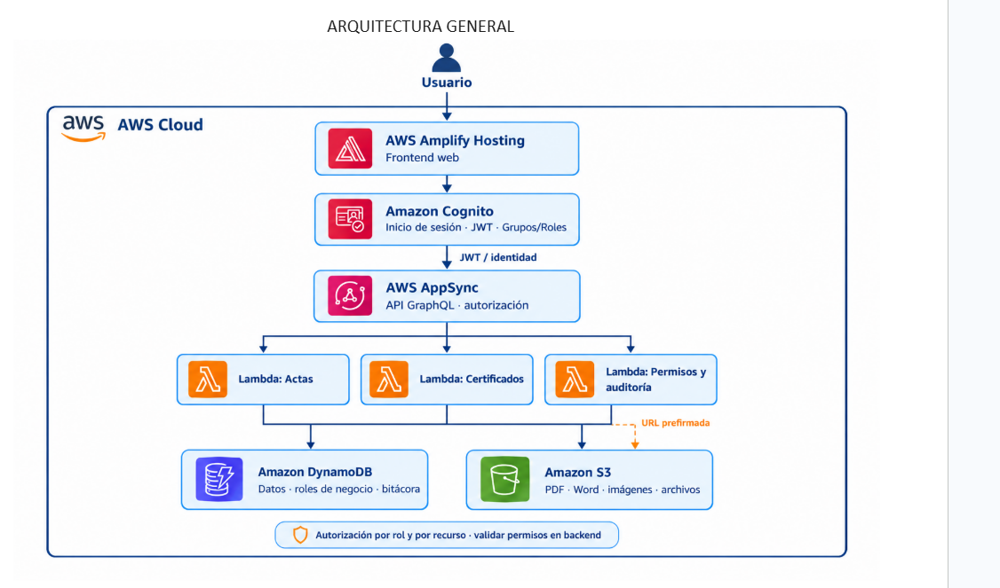

# Resguardo DENEC · Archivo vivo

Sistema web para resguardar la documentación de la iglesia DENEC: actas, fotos, videos, credenciales e informes.

- **Frontend:** Vue 3 + Quasar (Vite)
- **Backend:** AWS Amplify Gen 2 (serverless, pago por uso)
- **Diseño:** Figma, página "Prototipo v2 · Archivo vivo"

## Arquitectura



| Capa del diagrama | Dónde está en el código |
|---|---|
| AWS Amplify Hosting | `amplify.yml` (build) |
| Amazon Cognito (login, JWT, grupos) | `amplify/auth/resource.ts` (grupos `ADMINISTRADOR` y `MIEMBRO`) |
| AWS AppSync (GraphQL) + DynamoDB | `amplify/data/resource.ts` (modelos = tablas) |
| Lambda: Actas (Documentos y Multimedia) | `amplify/functions/actas/` |
| Lambda: Certificados (Credenciales) | `amplify/functions/certificados/` |
| Lambda: Permisos y auditoría | `amplify/functions/permisos-auditoria/` |
| Amazon S3 (PDF, Word, imágenes) | `amplify/storage/resource.ts` |

**Base de datos:** el diagrama entidad-relación de las tablas DynamoDB está en [`docs/base-de-datos.md`](docs/base-de-datos.md).

**Regla principal:** la autorización por rol y por recurso **siempre se valida en el backend**. Que un botón no aparezca en el frontend no basta como seguridad.

## Estructura

```
DENEC/
├── amplify/                 # Backend (AWS)
│   ├── auth/                # Cognito
│   ├── data/                # AppSync + DynamoDB (esquema)
│   ├── storage/             # S3
│   ├── functions/           # Las 3 Lambdas
│   └── backend.ts           # Une todo
├── src/                     # Frontend (Vue + Quasar)
│   ├── layouts/AdminLayout.vue   # Barra lateral del Figma
│   ├── pages/               # Pantallas
│   ├── router/              # Rutas + protección por sesión/rol
│   ├── stores/auth.js       # Sesión de Cognito (Pinia)
│   └── amplify.js           # Conexión con AWS
├── amplify.yml              # Build en Amplify Hosting
└── arquitectura.png
```

## Cómo empezar (cada integrante)

### 1. Requisitos
- [Node.js](https://nodejs.org) 20 o superior
- [Git](https://git-scm.com)
- [AWS CLI](https://aws.amazon.com/cli/), solo si vas a usar tu propio sandbox de AWS

### 2. Clonar e instalar
```bash
git clone <URL-del-repositorio>
cd DENEC
npm install
```

### 3. Ver la app sin AWS (modo vista previa)
```bash
npm run dev
```
Abre http://localhost:5173, ve a **Acceso con credencial** y entra con **"Entrar en modo vista previa"**. Así puedes revisar y construir pantallas sin conectarte a AWS.

### 4. Conectar con AWS (sandbox personal)
Cada integrante tiene su propio sandbox, así nadie pisa los datos de los demás.

```bash
aws configure          # una sola vez, con tus credenciales de AWS
npm run sandbox        # crea Cognito, AppSync, DynamoDB, S3 y las Lambdas en tu cuenta
```
- Al terminar, se genera `amplify_outputs.json` (no se sube a GitHub) y la app ya usa AWS.
- Deja el sandbox corriendo mientras trabajas: cada cambio en `amplify/` se despliega solo.
- Para borrar tus recursos: `npm run sandbox:delete`.

**Crear el primer administrador:** entra a la consola de AWS → Cognito → tu User Pool → *Users* → *Create user*. Luego, en *Groups* → `ADMINISTRADOR`, agrégalo.

## Reglas para trabajar en equipo

1. Nunca trabajes directo en `main`. Crea una rama por tarea: `git checkout -b semana2/documentos-listado`.
2. Haz commits pequeños con mensajes claros: `feat(documentos): subir PDF a S3`.
3. Sube tu rama y abre un **Pull Request**. Otra persona lo revisa antes de unirlo a `main`.
4. **Nunca subas credenciales** (`.env`, claves de AWS, `amplify_outputs.json`). El `.gitignore` ya las excluye.

## Despliegue (Amplify Hosting)
1. Consola de AWS → **Amplify** → *Create new app* → conectar el repositorio de GitHub → rama `main`.
2. Amplify detecta `amplify.yml` y despliega backend y frontend.
3. En *Hosting → Rewrites and redirects*, agrega la regla para la SPA (Vue Router):
   - Source: `</^[^.]+$|\.(?!(css|gif|ico|jpg|js|png|txt|svg|woff|woff2|ttf|map|json|webp)$)([^.]+$)/>`
   - Target: `/index.html` · Type: `200 (Rewrite)`

## Estado actual (base)

- [x] Proyecto Vue 3 + Quasar con la paleta y tipografías del Figma
- [x] Backend Amplify Gen 2: Cognito con grupos, esquema de datos (8 modelos), S3 por carpetas, 3 Lambdas conectadas a AppSync
- [x] Pantalla de **Ingreso** conectada a Cognito
- [x] Barra lateral, rutas protegidas por sesión y por rol
- [ ] Resto de pantallas → ver el plan de 8 semanas
