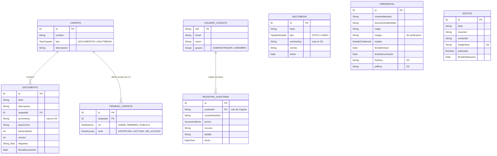

# Base de datos — Resguardo DENEC

Amplify Gen 2 crea una tabla de **DynamoDB** por cada modelo definido en [`amplify/data/resource.ts`](../amplify/data/resource.ts). Los usuarios no son una tabla: los guarda **Amazon Cognito**. Los archivos (PDF, Word, fotos, videos) viven en **S3**. Las tablas solo guardan su ruta (`archivoKey`, `pdfKey`, etc.).

Amplify agrega `createdAt` y `updatedAt` a todas las tablas.

## Quién puede leer y escribir cada tabla

| Tabla | HU | Administrador | Miembro | Público |
|---|---|---|---|---|
| Carpeta | HU-05 | Todo | Lectura | — |
| Documento | HU-05, 08, 23, 24, 29 | Todo | Lectura | — |
| PermisoCarpeta | HU-27 | Todo | Lectura | — |
| Multimedia | HU-09 | Todo | Lectura | — |
| Credencial | HU-14 | Todo | — | — |
| RegistroAuditoria | HU-25 | Solo lectura (solo las Lambdas escriben) | — | — |
| Noticia | HU-33 | Todo | Lectura | Lectura |

AppSync valida estas reglas en el backend en cada consulta. Además, la Lambda **Permisos y auditoría** revisa `PermisoCarpeta` antes de entregar una URL prefirmada de S3.
